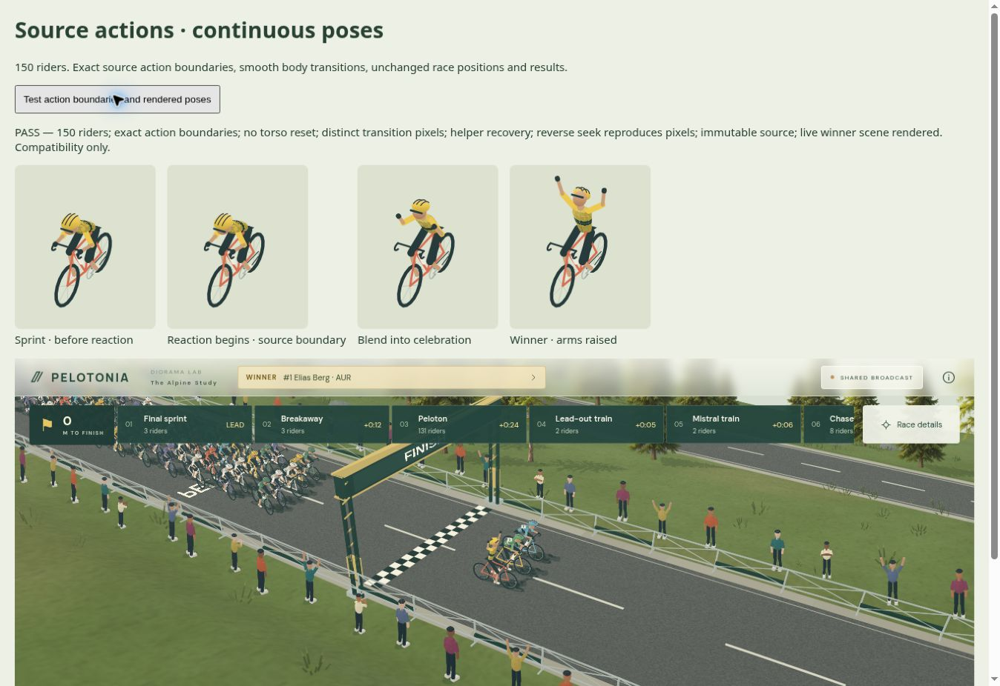

# Sammenhængende handlinger · 0.61

Når motorens eksport skifter direkte mellem to handlinger, bevarer rytteren nu sin positur ved grænsen og glider ind i den næste. Det fjerner et utilsigtet kort sædeskift mellem stående indsatser og en nulstilling mellem spurt og jubel.

- Den semantiske handling ændres præcist på motorens tidspunkt. Kun kropsposituren glattes.
- Pauser mellem intervaller forbliver pauser. Ordrer uden en faktisk handling skaber ingen indsats eller jubel.
- Meget korte intervaller og eksplicit afslutning af jubel håndteres. Posituren afhænger af absolut tid, så søgning i tidslinjen kræver ingen tidligere animationsframes.
- Positioner, gruppedannelse, kadence og resultater ændres ikke. Der er ingen ny løbssimulering.

193 automatiske tests passerer. Browserens test med 150 ryttere kontrollerer den nøjagtige handlingsgrænse, sammenhængende torso, forskellige pixels gennem jubelovergangen, hjælperens restitution og identiske pixels efter tilbagesøgning. Den levende scene gengives ved hver tidsændring.

Inputkontrakten er fortsat `pelotonia.viewer.v1`. `actionTransition` er afledt outputmetadata. GPU på rigtig hardware og den endelige grafiske kvalitet er stadig åbne godkendelsespunkter. Compatibility-rendererens kvantiserede positurer bliver ikke til kontinuerlig GPU-gengivelse af denne ændring.

Den installerede 0.61-pakke består strict Next.js-produktionsbuild samt browseracceptance med to 150-rytter-tilskuere. Kontrollen læser de nye nabo-handlinger gennem den offentlige, typede API og kontrollerer fælles ur, uafhængige kameraer, tilbagesøgning, indlæsningsfejl, retry og genåbning. De installerede runtimefiler er identiske med de pakkede filer.
