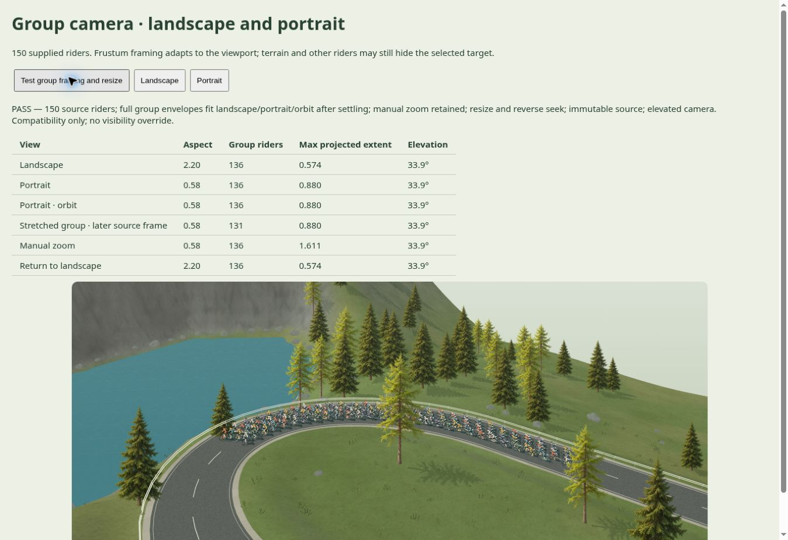
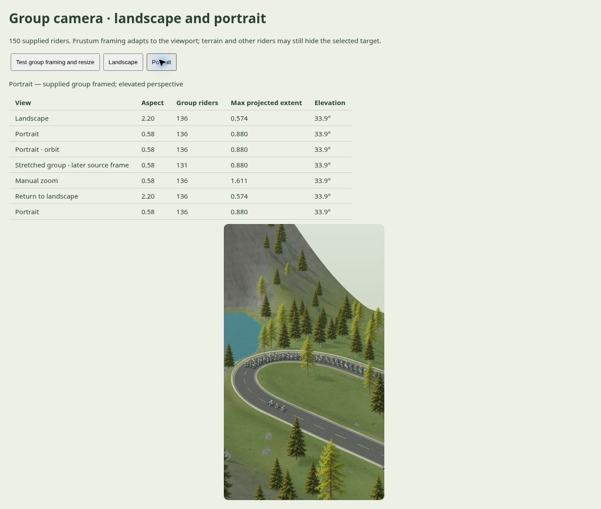

# Kameraets indramning · 0.63

Den tidligere afstandsregel havde et fast loft og tog ikke højde for skærmens proportioner. En lang gruppe kunne derfor blive beskåret på en smal skærm.

Nu beregnes kameraafstanden ud fra de valgte rytteres faktiske positioner, kameraets synsfelt og skærmens bredde/højde. En konservativ ramme omkring hver cykel og rytter inkluderer hældning og løftede arme. Ved standardzoom holdes disse rammer inden for 88 % af det normaliserede synsfelt, når kameraet har fundet ro.

- Den hævede vinkel bevares under følgevisning og rotation.
- Manuel zoom er stadig tilskuerens eget valg og kan bevidst beskære gruppen.
- Der flyttes ingen ryttere. Terræn og andre ryttere kan stadig skjule den valgte rytter.
- Den fælles løbstid ændres ikke af skærmstørrelse eller kameravalg.
- Den faktiske kameraposition, fokus, synsfelt, skærmproportion og beregnede indramningsskala kan læses gennem den typede kamera-API. Returnerede vektorer er kopier.

201 automatiske tests passerer. De nye kontroller projicerer alle 150 rytterrammer gennem et faktisk Three.js-kamera på brede, kvadratiske og smalle flader ved fem forskellige vinkler. Inddata bevares. Enkelt-ryttervisningens nære grundafstand og forholdet til manuelt zoom kontrolleres separat.

Indramning er ikke en garanti for frit udsyn, læsbare små ryttere eller fuld terrændækning på vilkårligt store afstande. Compatibility-rendereren har stadig et begrænset lokalt terrænvindue. Kameraklipning og WebGL-tåge tilpasses større indramninger, men dette indfører ikke et atlas eller geografisk streaming. GPU på rigtig hardware og den samlede grafiske kvalitet er ikke godkendt.

## Gengivet kontrol

Browserkontrollen passerer landskab (2,20:1), portræt (0,58:1), rotation, et senere kildeframe med ændret gruppestørrelse, manuelt zoom og tilbagevenden til landskab. Den valgte gruppe indeholder 136 henholdsvis 131 ryttere fra den uændrede 150-ryttereksport. Hældningen er 33,9°. Portrætvisningen holder rytterrammerne inden for 0,880 normaliseret projektionsudstrækning. Tæt manuelt zoom giver med vilje større udstrækning.

Kontrollen accepterer genbrug af en allerede korrekt, statisk frame ved en uændret anmodning. Faktiske ændringer i størrelse, tid, vinkel eller zoom kræver en ny gengivet frame.

## Integration og datavej

| Grænse | Kontrol |
| --- | --- |
| Kildepositioner → rytterrammer | 201 tests; inddata og rytterhandlinger bevares |
| Skærmstørrelse/orbit → kamera | Gengivet bred/smal browserkontrol passerer |
| Kamera-API → installeret Next.js-pakke | Strict build og browserkontrol med to 150-rytter-tilskuere passerer |
| Fælles ur → lokale kameraer | Tilbagesøgning, individuelle kameravalg, fejl/retry og genåbning passerer |
| GPU på målenhed | Ikke godkendt; browserbeviset er Compatibility |

De installerede runtimefiler matcher pakkens viewer.js/data.js. Ingen produktionsmotor, database eller atlas er tilsluttet.
