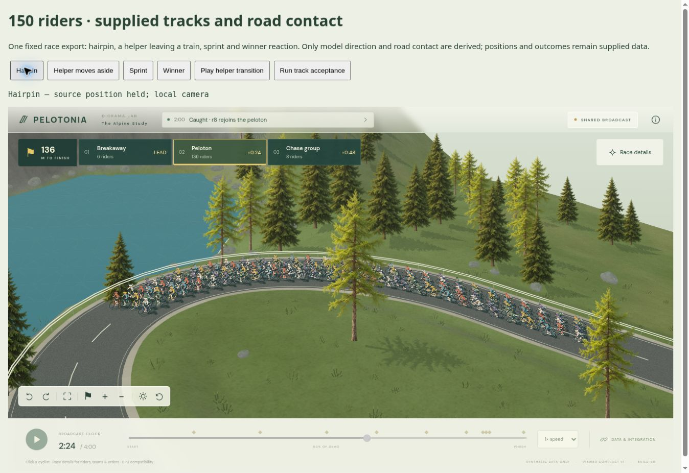
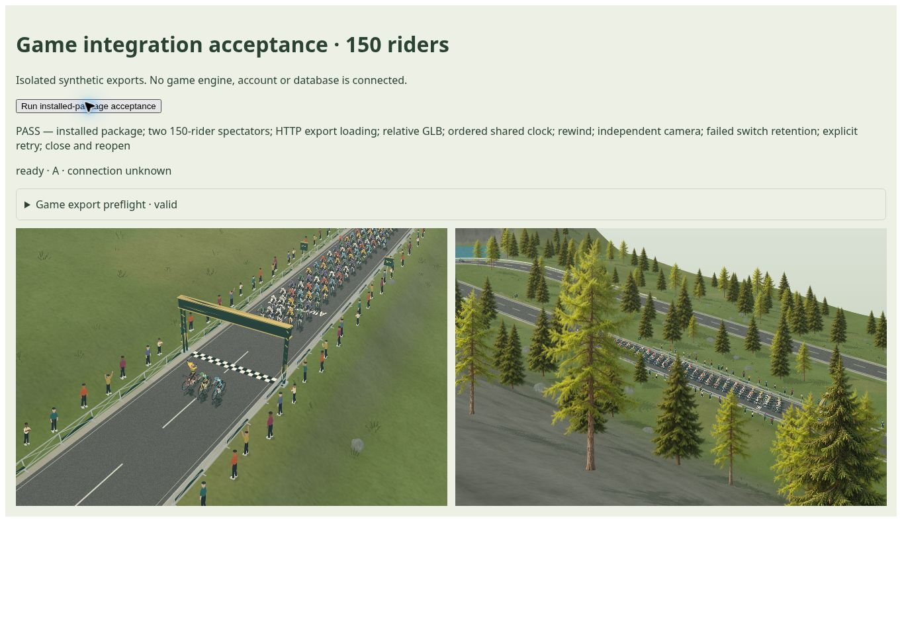

# Bevægelse og vejkontakt · 0.60

Denne runde retter gengivelsen af leverede rytterspor. Den afslutter ikke den samlede grafiske milepæl.

## Ændret adfærd

- Cyklernes retning følger både fremdrift og sideskift i de leverede positioner. En hjælper, der forlader et tog, drejer nu med sit spor i stedet for blot at glide sidelæns med vejens retning.
- Retningen beregnes over et deterministisk vindue på ±0,25 sekund. Det ændrer ingen positioner, ordrer, gruppedannelser eller resultater og integrerer ingen bevægelse.
- CPU-gengivelsen bruger samme modelankring og asfaltplan som Three.js-modellen. Det fjerner en konkret forskel i hjulenes placering mellem de to renderere.
- Dæk, fælge og skygger er justeret til den fælles vejflade. Modellens hældning tager højde for vejens lokale plan og det leverede spor.

`displayVelocity` er afledt outputmetadata. Inputkontrakten `pelotonia.viewer.v1` er uændret; producenten skal ikke levere et nyt felt.

## Kontrol

189 automatiske tests passerer. De nye kontroller omfatter 150 faktiske instancer, sideskift, stejle lokale vejplaner, dækkenes frigang og identiske matricer efter tilbagesøgning. Kildepositionerne forbliver uændrede.

Browserens track-acceptance passerer hårnålesving, hjælperens sideskift, spurt, vinderreaktion og tilbagesøgning. Den afspillede hjælperovergang stopper korrekt ved 218 sekunder. Browserkontrollen bruger Compatibility-rendereren.

## Afgrænsning

Vejkontakten kontrolleres mod det lokale vejplan. Det er ikke en rigid cykelfysikmodel eller en garanti mod alle facetter på vilkårlige skarpe bakketoppe. Compatibility-rendereren kvantiserer stadig retninger og positurer. GPU-rendering og ydeevne på rigtig hardware er ikke godkendt. Billedkvaliteten er fortsat en prototype og er ikke godkendt mod referencebilledet.

Den installerede 0.60-pakke består strict Next.js-produktionsbuild og browseracceptance med to 150-rytter-tilskuere, fælles ur, individuelle kameraer, tilbagesøgning, HTTP-indlæsning, fejl ved løbsskift, retry og genåbning. Bibliotekets runtimefiler er identiske med de installerede filer. Den eksisterende raster- og kliktest for vejpositurer og delvis/fuld terrænskjulning passerer også.

