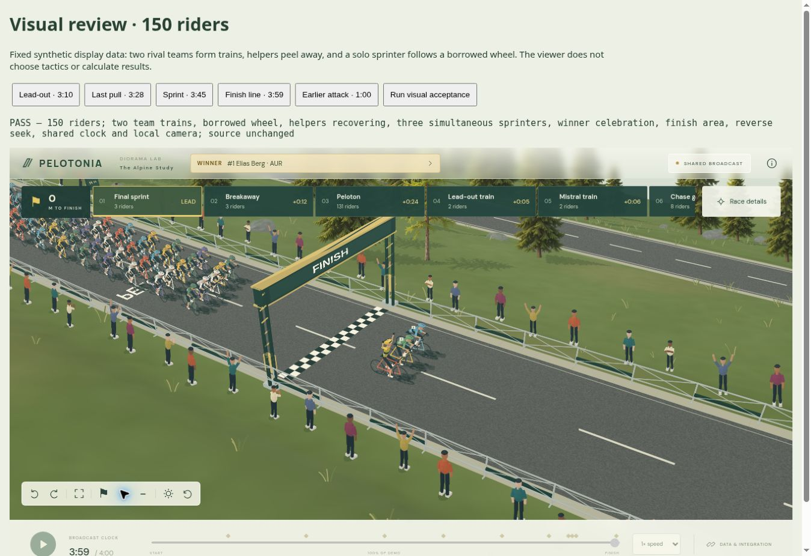

# Ryttergrafik og fælles model — 0.57

Runden samler rytterens kropsform og trøjekort på tværs af WebGL og CPU Compatibility. Der er ingen ændringer i motorens positionsdata, taktikker, resultater, rute eller terræn.

## Ændringer

- En kropsformet trøje erstatter WebGL-kapslen og CPU-visningens flade firkant. Den har smallere talje, bredere skuldre, et lukket skulderparti omkring halsen og et fælles UV-kort. Holdtrøjer, ledertrøjer og importerede teksturer bruges fortsat fra feedet.
- CPU-visningen sorterer cykeldele, arme, ben, trøje og hoved efter kameradybde inden for den enkelte rytter. Den fjerne arm tegnes dermed ikke ubetinget oven på kroppen. Det er en forbedret painter-visning, ikke en fuld CPU-z-buffer til alle rytterdele.
- Trøjens CPU-belysning følger solretningen i verden, når kameraet drejer. Kameraets lysretning og dag/aften indgår i den begrænsede spritecache.
- Rygnummrene er mindre, flyttet ind til trøjen og vendt med toppen mod skuldrene i WebGL. CPU-nummerets placering og størrelse er rettet tilsvarende; teksten er stadig en enkel skærmprojektion.
- Handsker og sokker er tilføjet begge renderere. De følger håndled og det bevægelige underben under angreb, spurt og jubel.
- De nye detaljer er batchede i WebGL. Der tilføjes to instanced meshes til hele feltet, ikke separate meshes pr. rytter.

## Integration

Dataformatet er fortsat viewer contract v1. Der kræves ingen nye felter. Trøje-UV følger én omvikling rundt om kroppen: u=0/1 er forsiden/sømmen og u=0,5 er ryggens midte; v=0 er talje og v=1 er skuldre i Three.js. Et billede har derfor toppen ved skuldrene. Den eksisterende tekstur er fortsat input; farve og kontrast påvirkes af lys i rendereren. Importerede trøjer skal visuelt kontrolleres på denne kropsmodel ved spillets senere integration.

## Afprøvning og grænser

173 automatiske tests består. De nye tests kontrollerer UV, udadvendte flader, sømnormaler, rygnummervending og hånd-/fodkontakt gennem flere handlinger og omvendte seeks. Produktionsbuild består.

Browserens 150-rytterprøve består med to sprinttog, en solosprinter, hjælpere der slipper, samtidige spurter, vinderjubel, officiel vinder, tilbagespoling og uændret kildefeed. Den installerede 0.57-pakke består også et separat strict TypeScript/Next.js-produktionsbuild, servervalidering og browserprøven med to tilskuere med hver 150 ryttere. Detaljer er i VALIDATION.md.

Billedet nedenfor er den faktiske CPU Compatibility-visning. GPU-hardwareydelse og referencens samlede grafiske kvalitet er fortsat åbne punkter. Dette er ikke en færdigmelding af hele vieweren.

