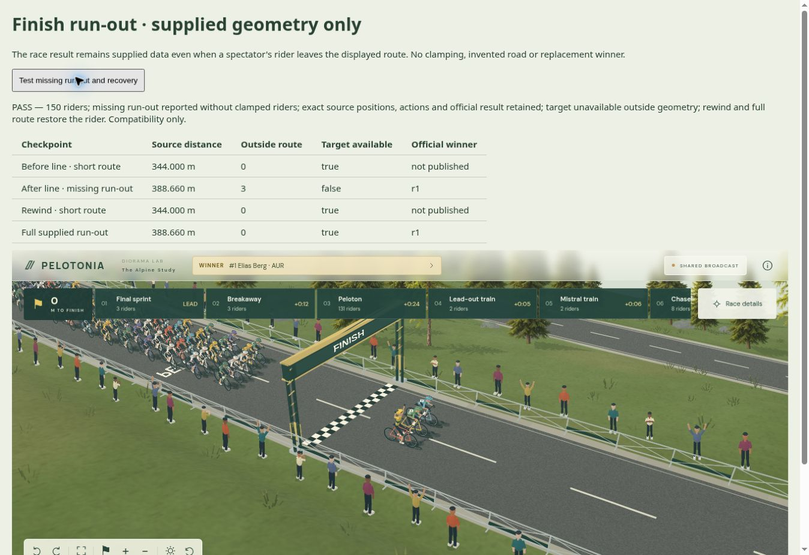

# Målgang og rutedækning · 0.62

En konkret integrationsfejl er rettet: ryttere uden for den leverede rutes distanceakse blev tidligere gengivet på rutens endepunkt. Det kunne samle flere cykler på samme sted, hvis eksporten manglede udløb efter mål.

Nu tegnes disse ryttere ikke på en opdigtet position. Kildeposition, handling, gruppe og officielt resultat forbliver tilgængelige og uændrede. Der genereres ingen ekstra vej eller geografi. Når en leveret position igen ligger på ruten, vises rytteren igen.

Integrationen kan læse `routeCoverage` med rutelængde, antal dækkede ryttere og lister over rytter-ID'er før start og efter slut. Snapshot gælder det aktuelle beregnede tidspunkt; diagnosticering gælder sidst gengivne frame. Kameraets `targetAvailable` kræver rutedækning, men lover hverken frit udsyn eller at rytteren er på skærmen. Et allerede følgende kamera holder sit sidste tilgængelige fokus, når rytteren forlader rutens geometri.

198 automatiske tests passerer. Nye kontroller omfatter alle dele af 150-ryttermodellen: skjulte cykler, hjul, lemmer, rygnumre og klikmål, nøjagtige endepunkter, tom rutedækning, gendannelse ved tilbagesøgning og uændrede kildedata/resultater.

Inputkontrakten er fortsat v1. Producenten skal levere tilstrækkelig geometri omkring mål og bør levere `distanceStations`, så distanceaksen er eksplicit. Det er ikke globus-/atlas-streaming. GPU-test og godkendelse af den samlede grafik mangler stadig.

Browserkontrollen passerer med en bevidst afkortet syntetisk rute: tre ryttere er uden for geometrien efter mål; den oprindelige vinder og jubel bevares. Tilbagesøgning og indlæsning af den fulde rute gendanner visningen. Et mislykket tegneforsøg erstatter ikke diagnosen for den sidst fuldførte frame.

Den installerede pakke er kontrolleret i det separate Next.js-projekt med strict TypeScript og to 150-rytter-tilskuere. Fælles tid, individuelle kameraer, tilbagesøgning, indlæsningsfejl/retry og genåbning passerer. Runtimefilerne matcher den byggede pakke.
