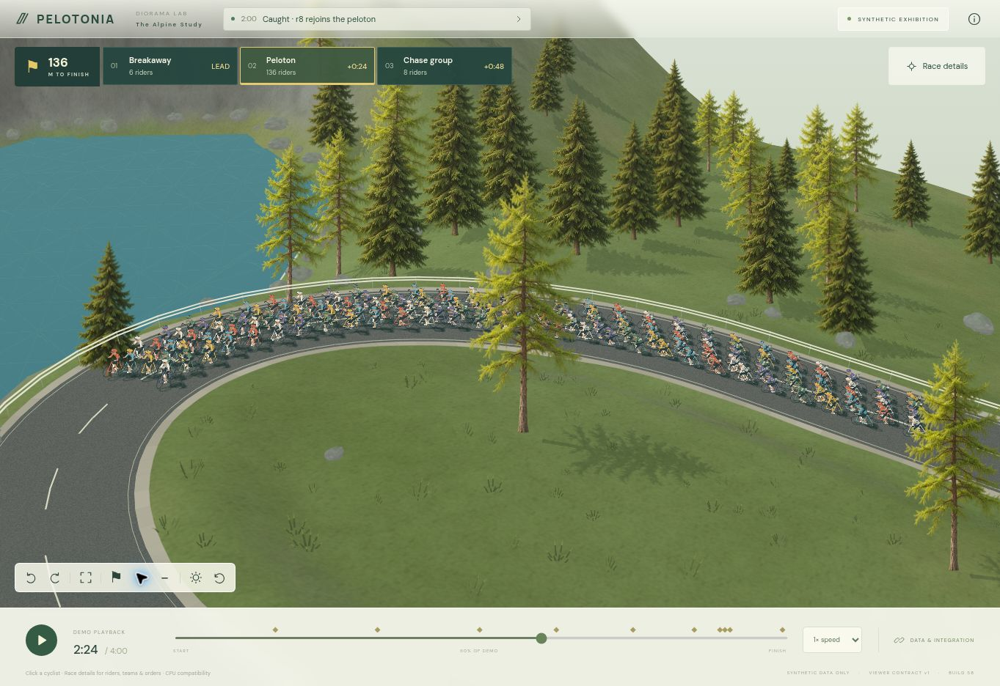
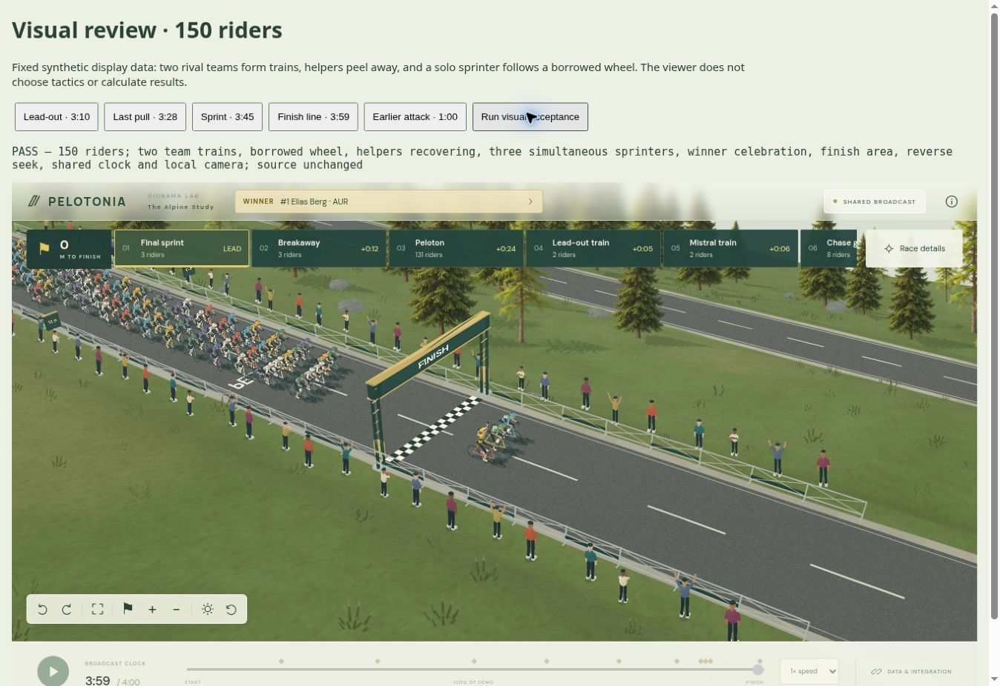

# Terrænmaterialer og fælles græsgeometri — 0.58

Runden forbedrer materialerne tæt på kameraet. Rute, højdefelt, placeringer, ryttersamples, ordrer og resultater ændres ikke. Tennedz, motor, database og atlas er fortsat ikke tilsluttet.

## Implementeret

- Standardterrænet har et deterministisk detaljelag med 16 meters gentagelse i verdenskoordinater. Kameraets bevægelse ændrer ikke mønstrets placering eller målestok. WebGL lægger materialedetaljen ind i standardmaterialets lys-/skyggeberegning.
- CPU Compatibility bager nærliggende materialefelter i en begrænset cache på højst 32 MiB RGBA-pixels; browserens øvrige overhead kommer oveni. Felterne er 32 meter med en firemeters margen på hver side, så komplette terrænceller også dækkes ved en cachegrænse. Fjernere terræn bruger fortsat det eksisterende oversigtsbillede.
- Når et importeret terrænbillede er indlæst, deaktiveres standarddetaljen i begge renderere. Det gælder også efter en asynkron billedudskiftning. Den eksisterende CPU-belysning af importbilledet bevares.
- CPU-græs bruger nu præcis samme kurvede bladgeometri og kildeplaceringer som WebGL. De tidligere fem tegnede strøg er fjernet. Der genereres ikke ekstra græsplaceringer i rendereren.
- Materialet i rabatten varierer diskret langs den leverede rute. Rabatten ligger uden for asfaltens fulde bredde; hverken cyklisternes positioner eller vejens bredde forskydes.
- Der er en ny selvstændig browserprøve, material-test.html, som kan vise standardmateriale, et importeret diagnostisk billede og gendannelse med 150 ryttere.

## Visuel iteration

Den første tekstur gav for regelmæssige riller i browseren. Lange, gennemgående fibre blev derfor erstattet af korte, uregelmæssige detaljer, og kontrasten blev reduceret. Billederne nedenfor viser den endelige justering, ikke første pass.

## Integration og afprøvning

Viewer contract v1 er uændret, og spillet skal ikke levere nye felter. Producentens terrænbillede overtager fortsat fra standardmaterialet. Standardmaterialets fibre er overfladefarve; de tilføjer ikke terrænrelief, bygninger, planter eller anden atlasgeografi.

179 automatiske tests består. De nye kontroller dækker deterministiske materialepixels, shaderens verdenskoordinater og importfrakobling, cachegrænser og negative koordinater, dags-/aftencache, hukommelsesgrænse, fælles GPU/CPU-græsgeometri og rabat uden for asfaltbredden.

Browserprøverne består med 150 ryttere: fuld finale med vinder, rivaliserende tog og tilbagespoling samt preview/import/restore og lokal kamerarotation uden ændring af fælles ur eller kildefeed. Den installerede pakke består også et separat strict TypeScript/Next.js-produktionsbuild, servervalidering gennem /data og browserprøven med to samtidige viewere med hver 150 ryttere. Detaljer er i VALIDATION.md.

Cloud-browseren bruger CPU Compatibility. GPU-shaderens hardwareudførelse og ydelse er ikke verificeret her, og CPU- og GPU-lys er ikke pixelidentiske. Ingen ny FPS-forbedring eller samlet færdigmelding af grafikken påstås.
