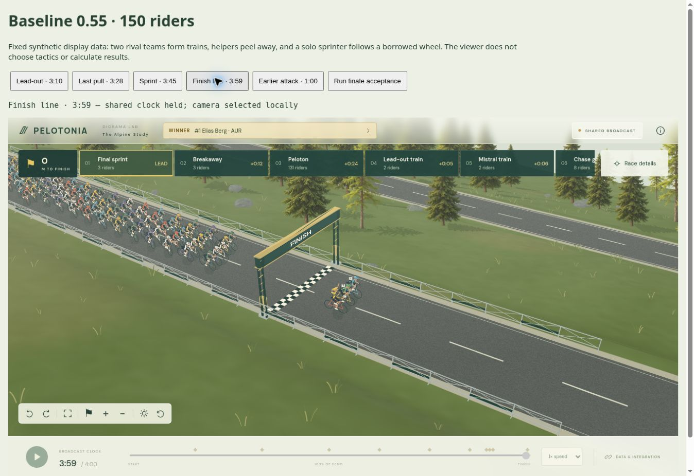
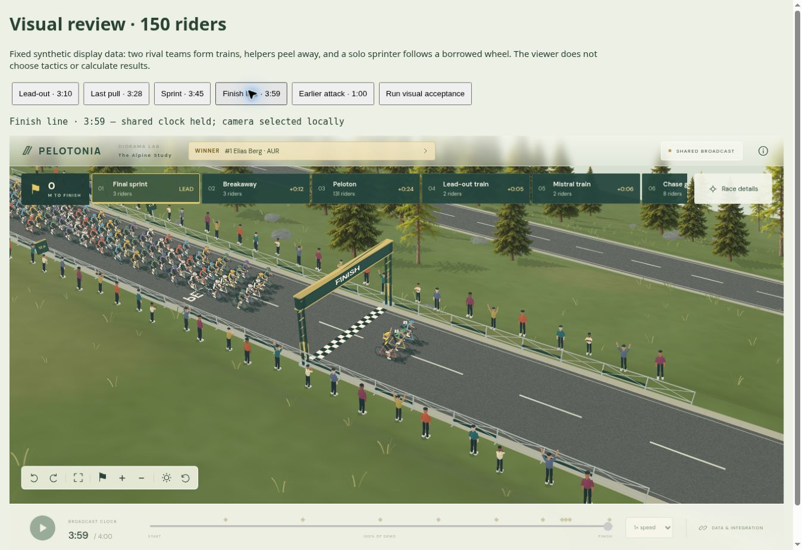

# Visuel udviklingsrunde — 0.56

Denne runde samler ændringer i den faktiske løbsvisning frem for flere integrationsfunktioner. Tennedz, motoren, databasen og atlasset er ikke ændret.

## Synlige ændringer

- Målområdet har 60 kildeplacerede tilskuere i den syntetiske demo. Højde, farver og statiske positurer varierer. Et rigtigt spil bestemmer selv positioner og udseende; publikum genereres ikke i atlasgeografien af rendereren.
- Afstandsskilte ved 100, 50 og 25 meter samt bemaling på asfalten giver finalen en tydeligere identitet. Begge dele er valgfrie finishdata. De åbne barrierer bevares, og hele vejbredden er fri.
- Cykelmodellen har en lavere krankboks under hjulakslerne, 170 mm pedalarme samt kæde-/geardetaljer. CPU- og WebGL-modellen bruger samme pedal- og benmål.
- Den stående bevægelse er mindre og holder benene inden for deres rækkevidde. Der er stadig nul ændringer i motorens leverede positioner, fart eller kadence.
- CPU-visningen projicerer nu rytterens skygge fra den fælles solretning på den leverede vejflade. Skygger følger pedalstilling, torso og arme og klippes ved asfaltkanten. Den gamle skygge inde i rytterspriten er fjernet.
- Mindre atmosfærisk vask giver mere kontrast i CPU-visningen. Tættere zoom og en skrå målkameravinkel gør ryttere og finale lettere at læse, mens den forhøjede kameravinkel bevares.

## Iteration og afprøvning

Første pass gav et bedre målområde, men en lokal CPU-måling steg fra cirka 195 til 260 ms i samme scene. Tilskuerne blev derfor lagt i en separat, pixelbegrænset 16 MiB cache i CPU-rendereren. Cachen beholder geometrien og den verdensfastlåste lysretning; publikum er fortsat geometri i WebGL-rendereren. I næste lokale stikprøve var tiden cirka 204 ms, mens baseline samtidig var cirka 182 ms. Efter den sidste udvidelse til 60 tilskuere blev der også observeret en stikprøve på cirka 268 ms; resultatet varierer, og den sidste scene har flere figurer end optimeringsprøven med 40. Det ekstra visuelle indhold er således ikke gratis i CPU-fallback. Dette er enkeltmålinger i cloud-browseren, ikke et hardwarebenchmark eller en garanti for billedhastighed.

170 automatiske tests består. De nye kontroller omfatter benenes rækkevidde gennem hele pedalomdrejningen, pedalfrihøjde, skrånende vejskygger, asfaltklipning, tilskuerplacering, oprydning, cachebelysning og korte ruter uden plads til vejtekst.

Til sammenligningen er 0.55 genbygget fra commit `c0932ed40d0c98276734ea4d9133cf2de2f7a3c8`. Rytterframes, ordrer, handlinger, events, rute, terræn, ryttere, hold og resultater er kontrolleret identiske med den nye demo. Det er renderingen og de nye dekorationsdata, der er ændret. Samme tidspunkt 239,5 sekunder, samme gruppe, yaw 0 og zoom 0,55 bruges i sammenligningsbillederne.

En tættere visning findes som `docs/validation/visual-056-close.png`. Browseracceptance og den endelige installerede pakkeprøve registreres i VALIDATION.md.

## Grænser

De faktiske billeder er fra CPU Compatibility-visningen. Den tilsvarende geometri er implementeret i WebGL, men målmaskinernes GPU-ydelse og endelige visuelle kvalitet er stadig ikke godkendt. Referencens samlede detaljeniveau i landskab og assets er ikke færdigopnået. Der er ikke bygget en vulkan, hængebro, katedral eller et globalt atlas i denne runde.
